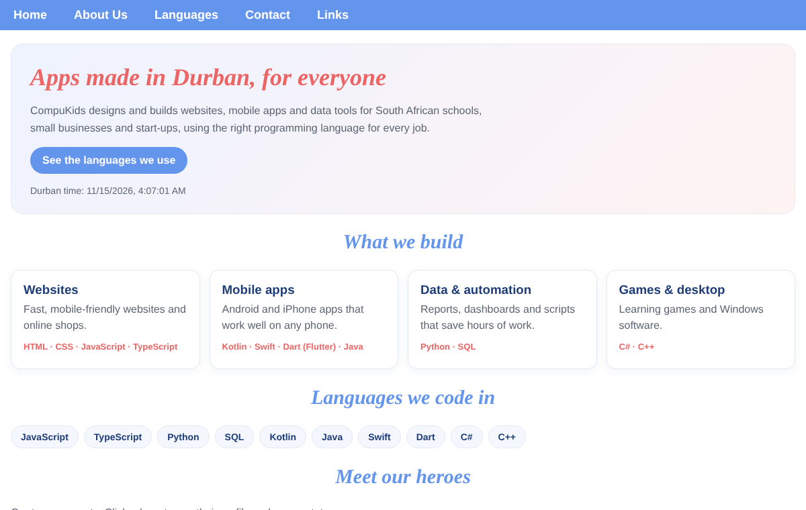
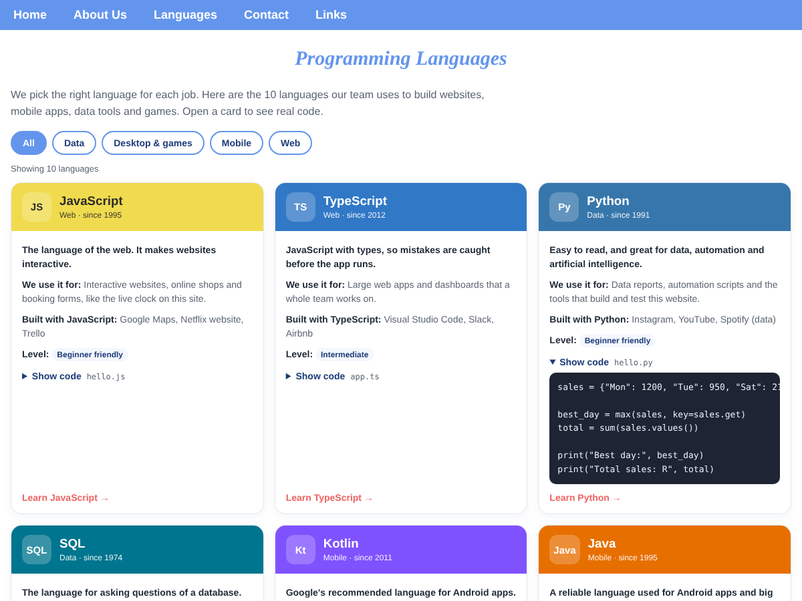
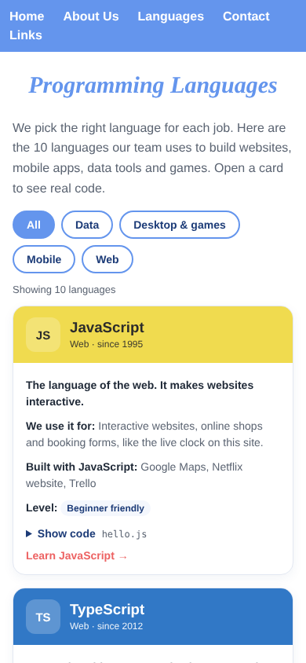

# CompuKids Website

A multi-page website for **CompuKids**, a fictional app development company based in Durban, South Africa. I built it during the **FNB App Academy** training to practise HTML, CSS and JavaScript, and I added Python tools to generate and test the site.

**Live demo:** https://ukhezo.github.io/COMPUKIDS-WEBSITE-1/

[](https://github.com/Ukhezo/COMPUKIDS-WEBSITE-1/actions/workflows/check-site.yml)



## Features

- **Programming Languages page:** 10 languages (JavaScript, TypeScript, Python, SQL, Kotlin, Java, Swift, Dart, C# and C++), each with what CompuKids uses it for, well-known apps built with it, a difficulty level and a code example
- **Language filters:** JavaScript buttons filter the cards by Web, Mobile, Data or Desktop & games
- **Services and about sections:** what the company builds, its mission and how it works
- **Live clock:** JavaScript shows the current date and time, updating every second
- **Responsive image gallery:** a CSS Grid gallery that adjusts to any screen size
- **Hero profile pages:** each Avenger has a page with a bio and power stats
- **Scrolling text:** a CSS keyframe animation (a modern replacement for `<marquee>`)
- **Navigation menu:** the same menu on every page, with hover effects
- **Mobile friendly:** a viewport meta tag and a flexible layout
- **Python page generator:** the six hero pages and the languages page are built from data files (`data/heroes.json` and `data/languages.json`)
- **Python link checker:** scans every page for broken links and missing images
- **Automated checks:** GitHub Actions runs the Python tools on every push

## Screenshots

| Programming Languages page | About page |
| --- | --- |
|  |  |

| Hero page | |
| --- | --- |
|  | |

| Contact page | Mobile view |
| --- | --- |
|  |  |

## Pages

| Page | File | Description |
| --- | --- | --- |
| Home | `index.html` | Welcome banner, services, languages and a gallery of six Avengers, with a live clock |
| Avengers | `avenger-1.html` to `avenger-6.html` | Bio and power stats for Thor, Iron Man, Hulk, Hawkeye, Captain America and Black Widow |
| About Us | `about.html` | Mission, services, how we work and key numbers, with scrolling text |
| Programming Languages | `languages.html` | 10 language cards with code examples and filters (generated by `tools/build.py`) |
| Contact | `contact.html` | Contact details and a live clock |
| Links | `links.html` | Site links and free official guides for each language |

## Python tools

### Page generator: `tools/build.py`

The hero pages and the languages page aren't edited by hand. Each hero's bio and power stats live in **`data/heroes.json`**, and each language's details and code example live in **`data/languages.json`**. The script turns that data into `avenger-1.html` to `avenger-6.html` and `languages.html` using shared templates, so every page has the same menu.

```bash
python tools/build.py
```

- To change a hero or add a language, edit the JSON file and run the script again.
- It checks the data first: required fields must be present, stats must be whole numbers from 0 to 100, and the image must exist.

### Link checker: `tools/check_links.py`

This script scans every HTML page and reports any link or image that points to a file that doesn't exist.

```bash
python tools/check_links.py
```

```
All links OK: checked 11 pages.
```

Both tools use only Python's standard library, so there's nothing to install.

### Automated checks

A GitHub Actions workflow (`.github/workflows/check-site.yml`) runs on every push and pull request. It:
1. Rebuilds the hero pages and fails if they're out of date with `heroes.json`
2. Runs the link checker

## Built with

- **HTML5:** semantic page structure and meta tags
- **CSS3:** Grid layout, keyframe animations and hover effects
- **JavaScript:** a live date and time with `setInterval`, and the language filters
- **Python:** a static page generator and a link checker
- **JSON:** the hero and language data
- **GitHub Actions:** automated testing

## Project structure

```
COMPUKIDS-WEBSITE-1/
├── index.html
├── about.html
├── contact.html
├── links.html
├── languages.html                    ← generated by tools/build.py
├── avenger-1.html … avenger-6.html   ← generated by tools/build.py
├── style.css
├── script.js
├── data/
│   ├── heroes.json                   ← hero bios and power stats
│   └── languages.json                ← programming languages and code examples
├── tools/
│   ├── build.py                      ← Python page generator
│   └── check_links.py                ← Python link checker
├── .github/workflows/
│   └── check-site.yml                ← automated checks
├── images/                           ← Avenger images
└── screenshots/                      ← README screenshots
```

## Run it locally

1. Clone the repo:
   ```bash
   git clone https://github.com/Ukhezo/COMPUKIDS-WEBSITE-1.git
   ```
2. Open `index.html` in any browser. Nothing needs to be installed.
3. Optional: with Python 3 installed, run `python tools/build.py` and `python tools/check_links.py`.

## What I learned

- Structuring a multi-page website and linking pages together
- Styling with external CSS, including Grid and animations
- Adding interactivity with JavaScript
- Using Git and GitHub, and hosting a site on GitHub Pages
- Generating pages from data with Python, so I don't copy and paste HTML
- The strengths of different programming languages and what each is used for
- Writing automated checks with Python and GitHub Actions

## Disclaimer

This is a training project. CompuKids and its contact details are fictional. Avengers characters and images belong to Marvel and are used for educational purposes only.

## Author

**Ukhezo** – [GitHub](https://github.com/Ukhezo)
